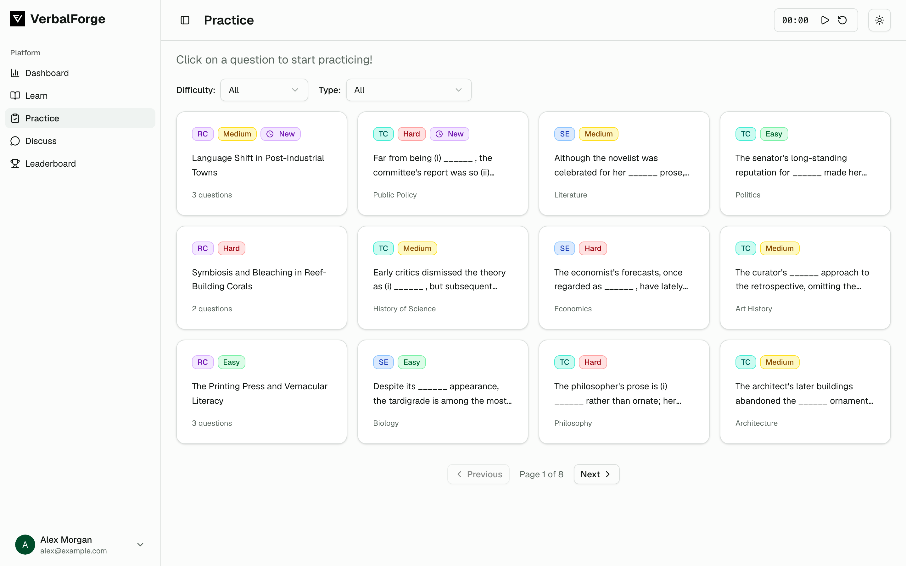

# VerbalForge Backend

VerbalForge is a GRE verbal practice platform whose questions are generated by an LLM pipeline. This repository is the Go/Gin REST API that serves those questions to the web app and stores users, progress, and community content in MongoDB.

Live site: https://www.verbalforge.xyz (may be offline)



*Screenshot uses demo data and a made-up user.*

## What this repo does

- **Auth**: email/password registration and login, Google sign-in, password reset, JWT-protected routes.
- **Practice**: one `/practice` endpoint that returns questions and reading comprehension passages together, with an in-memory cache. Non-admin users only see items that have been published.
- **Progress and stats**: answer attempts, per-question and per-passage progress, activity calendar, user stats, and a leaderboard.
- **Vocabulary**: word lists and per-user word status for the Learn page.
- **Community and support**: discussions with comments and likes, FAQ submissions, feedback, support tickets, file uploads (served from `/uploads`).
- **Admin**: edit, delete, bulk-publish, and bulk-delete questions and passages; manage words, discussions, FAQs, feedback, and support tickets; view user activity.

Questions and passages are written to MongoDB by [verbalforge-ai](https://github.com/VerbalForge/verbalforge-ai) with no publish date; an admin publishes them through this API before they appear in practice.

## Stack

Go, Gin, MongoDB (official Go driver), JWT (`golang-jwt`), bcrypt (`golang.org/x/crypto`).

## Run locally

Requires the Go version in `go.mod` and a reachable MongoDB instance.

```bash
go mod download
go run ./cmd/server
```

The server listens on `PORT` (default `8080`). `GET /health` returns `{"status":"ok"}`. If you have [air](https://github.com/air-verse/air) installed, `air` rebuilds and restarts on file changes using `.air.toml`.

Configuration is read from the environment, after loading a `.env` file from the current directory, `../`, or `../../`:

| Variable | Default | Purpose |
| --- | --- | --- |
| `MONGODB_URI` | `mongodb://localhost:27017/verbalforge` | MongoDB connection string. The database name is always `verbalforge`. |
| `JWT_SECRET` | placeholder | Secret for signing JWTs. Set this. |
| `FRONTEND_URLS` | `http://localhost:3000` | Comma-separated allowed CORS origins. The first entry is used for OAuth redirects. |
| `UPLOAD_DIR` | `./uploads` | Where uploaded files are stored. |
| `PORT` | `8080` | HTTP port. |
| `GOOGLE_CLIENT_ID`, `GOOGLE_CLIENT_SECRET` | empty | Google sign-in. |

Note: `.env.example` uses `MONGO_URI` and `FRONTEND_URL`, but the code reads `MONGODB_URI` and `FRONTEND_URLS`. Use the names in the table above.

## Project layout

```
cmd/server           Entry point: config, MongoDB, router
internal/routes      Route registration and dependency wiring
internal/handlers    HTTP handlers (internal/controllers for words)
internal/services    Business logic
internal/repository  MongoDB access
internal/models      Data models
internal/middleware  Auth, admin, CORS, logging
```

## Related repositories

| Repo | Role |
| --- | --- |
| [verbalforge-frontend](https://github.com/VerbalForge/verbalforge-frontend) | Next.js practice and admin UI that calls this API |
| **verbalforge-backend** (this repo) | Go/Gin REST API over MongoDB |
| [verbalforge-ai](https://github.com/VerbalForge/verbalforge-ai) | Python workers that generate and validate questions and write them to MongoDB |
